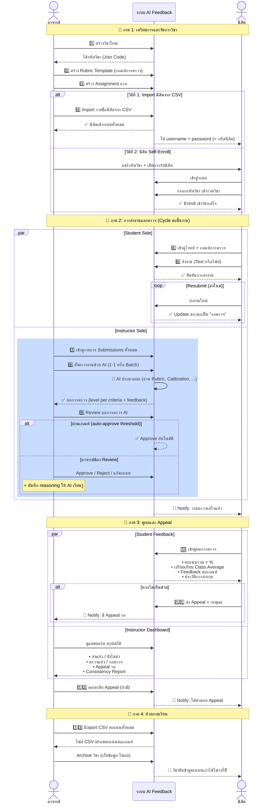

# Workflow: การใช้งานระบบร่วมกัน - อาจารย์และนิสิต

## Workflow Diagram



---

## 📋 ขั้นตอนรายละเอียด

### **ภาค 1: เตรียมการและจัดการวิชา** (ของอาจารย์)

| ขั้นตอน | อาจารย์ทำอะไร | ผลลัพธ์ |
|--------|-------------|---------|
| **1. สร้างวิชา** | กรอกชื่อวิชา, ภาคเรียน, สี, คำอธิบาย | ได้รหัสวิชา (Join Code) เช่น `3J4-7TB` |
| **2. สร้าง Rubric** | เพิ่มเกณฑ์การตรวจ (Criteria) + Levels | Template ตรวจสำหรับใช้ซ้ำได้ |
| **3. สร้าง Assignment** | กรอกชื่องาน, deadline, เลือก Rubric | นิสิตเห็นโจทย์และเกณฑ์ |
| **4. เพิ่มตัวอย่าง (Optional)** | Upload Calibration Examples + เหตุผล | AI เรียนรู้มาตรฐานของอาจารย์ |
| **5. Import นิสิต** | อัปโหลด CSV (กลุ่ม, รหัสนิสิต, ชื่อ) | นิสิตได้ account (username=รหัสนิสิต) |

---

### **ภาค 2: การส่งงานและตรวจ** (Cycle ของแต่ละการประเมิน)

#### **ฝั่งนิสิต:**

| ขั้นตอน | นิสิตทำอะไร | สถานะ |
|--------|----------|--------|
| **5. ดูงาน** | เข้า Assignment ดูโจทย์ + เกณฑ์การตรวจ | สถานะ: ยังไม่ส่ง |
| **6. ส่งงาน** | พิมพ์/วางข้อความ หรือ upload ไฟล์ (PDF/DOCX/TXT) | สถานะ: รอตรวจ |
| **6b. Resubmit** | ส่งใหม่ได้ทุกเมื่อ | สถานะ: รอตรวจ (update ตัวล่าสุด) |

#### **ฝั่งอาจารย์ (AI Grading Loop):**

| ขั้นตอน | อาจารย์/ระบบทำอะไร | สถานะ |
|--------|-----------------|--------|
| **7. ดู Submissions** | ดูรายการนิสิตที่ส่องงาน + กรอง/เรียงลำดับ | - |
| **8. สั่งตรวจ AI** | กด "สั่งตรวจด้วย AI" (1 คน หรือ Bulk) | สถานะ: กำลังตรวจ |
| **8b. AI Process** | AI อ่าน Rubric + Calibration Examples + Correction ล่าสุด → ประเมิน | - |
| **9. ดูผลการตรวจ** | อาจารย์เห็น avg level + reasoning + feedback ต่อเกณฑ์ | สถานะ: ตรวจแล้ว |
| **9b. Action: Approve** | Accept ผล AI เป็นคะแนนสุดท้าย | สถานะ: อนุมัติแล้ว |
| **9b. Action: Edit Level** | แก้ avg level ด้วยตัวเอง + บันทึก reasoning | สถานะ: อนุมัติแล้ว (AI จะเรียนรู้) |
| **9b. Action: Reject** | ปฏิเสธ — นิสิตต้องส่งใหม่ | สถานะ: ปฏิเสธ |

---

### **ภาค 3: ดูผลและ Appeal**

#### **ฝั่งนิสิต:**

| ขั้นตอน | นิสิตทำอะไร | เห็นอะไร |
|--------|----------|----------|
| **10. ดูผลการตรวจ** | กด "ดูผลการตรวจ" ในหน้าวิชา | • คะแนนรวม + %<br/>• เปรียบเทียบ Class Average<br/>• Feedback + Reasoning ต่อเกณฑ์ |
| **10b. ประวัติการส่ง** | ดูประวัติทั้งหมด ตรวจความก้าวหน้า | ทุกครั้งที่เคยส่ง + คะแนนแต่ละครั้ง |
| **11. ส่ง Appeal (Optional)** | ถ้าไม่เห็นด้วย → ส่ง Appeal + เหตุผล | สถานะ: รอการพิจารณา |

#### **ฝั่งอาจารย์:**

| ขั้นตอน | อาจารย์ทำอะไร | เห็นอะไร |
|--------|----------|----------|
| **Dashboard** | ดูแดชบอร์ด | • รอตรวจ / ตรวจแล้ว / รออนุมัติ<br/>• Appeal รอ<br/>• Consistency Report |
| **12. ตอบ Appeal** | อ่านเหตุผล → ตอบกลับ | นิสิตเห็นคำตอบ |

---

### **ภาค 4: ท้ายภาคเรียน**

| ขั้นตอน | อาจารย์ทำอะไร | ผลลัพธ์ |
|--------|-----------|---------|
| **13. Export CSV** | ดาวน์โหลดคะแนน (latest หรือ best) | ไฟล์ CSV: กลุ่ม, รหัส, ชื่อ, งาน1-n, รวม |
| **14. Archive วิชา** | Archive เพื่อเก็บข้อมูล (ไม่ลบ) | ข้อมูลยังเข้าดูได้ไม่ว่ากี่ปี |

---

## 🔄 Key Interactions

### **1. AI Learning Cycle**
```
อาจารย์ทำการแก้คะแนน + เขียน reasoning
                ↓
        ระบบเก็บ correction นี้
                ↓
        ครั้งถัดไปที่ตรวจงานเหมือนกัน
                ↓
        AI จะใช้ correction เหล่านี้เป็น few-shot examples
                ↓
        ผลการตรวจครั้งต่อจะแม่นยำขึ้น
```

### **2. Feedback Loop**
```
นิสิตอ่านผลการตรวจและ feedback
                ↓
        ปรับปรุงงาน
                ↓
        ส่งใหม่ (resubmit)
                ↓
        อาจารย์สั่งตรวจ AI ใหม่
                ↓
        เห็นคะแนนและ feedback ใหม่
                ↓
        วนรอบจนกว่าจะผ่าน
```

### **3. Quality Assurance**
```
AI ตรวจ → อาจารย์ review → (optional) แก้คะแนน
        ↓
    ระบบ track ทุก action (Audit Trail)
        ↓
    Consistency Report ตรวจว่าคะแนนสม่ำเสมอหรือไม่
        ↓
    หากมี outlier → ต้อง re-grade ใหม่
```

---

## 📊 Role & Permission

| การกระทำ | อาจารย์ | นิสิต |
|---------|--------|-------|
| สร้างวิชา | ✅ | ❌ |
| Enroll วิชา | ✅ (Import) | ✅ (Self-enroll) |
| ส่งงาน | ❌ | ✅ |
| สั่งตรวจ AI | ✅ | ❌ |
| Approve/Reject | ✅ | ❌ |
| ดูผล | ✅ (ทั้งหมด) | ✅ (เฉพาะของตัวเอง) |
| ส่ง Appeal | ❌ | ✅ |
| Export CSV | ✅ | ❌ |
| Archive วิชา | ✅ | ❌ |

---

## 🎯 Typical Flow per Assignment

```
Week N: อาจารย์สร้าง Assignment
         ↓
Week N-1 to N: นิสิตส่งงาน (อาจเฉพาะ 1-2 ครั้ง)
         ↓
Week N+1: อาจารย์สั่งตรวจ AI + Review
         ↓
Week N+2: นิสิตเห็นผล + อาจส่ง Appeal
         ↓
Week N+3: อาจารย์ตอบ Appeal (ถ้ามี)
         ↓
ท้ายภาค: Export คะแนน + Archive
```

---

## 💡 Best Practices

### **สำหรับอาจารย์:**
1. ✅ เพิ่ม **Calibration Examples 2-3 ชิ้น** ในแต่ละ Assignment เพื่อให้ AI แม่นยำ
2. ✅ บันทึก **reasoning อย่างละเอียด** เมื่อแก้คะแนน → AI เรียนรู้
3. ✅ ตรวจสอบ **Consistency Report** ก่อนจบ Assignment เพื่อหา outliers
4. ✅ ก่อนท้ายภาค ให้ **ดาวน์โหลด Backup DB** (`GET /api/admin/backup/db`) เพื่อเซฟข้อมูล
5. ✅ ก่อนท้ายภาค ให้ **Archive วิชาเดิม** ไว้อ้างอิงในภาคต่อไป

### **สำหรับนิสิต:**
1. ✅ อ่าน **Rubric (scale 1-4)** อย่างละเอียด ก่อนส่งงาน
2. ✅ ส่งงาน **หลายครั้ง** ถ้าคะแนนไม่พอใจ
3. ✅ อ่าน **Feedback ทั้งหมด** เพื่อปรับปรุงในงานถัดไป
4. ✅ ส่ง **Appeal ด้วยเหตุผลชัดเจน** ถ้าคิดว่าคะแนนไม่สมควร
